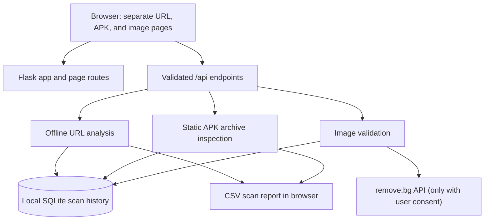

# Phishing URL & APK Security Analyzer

A local-first Flask application with three separate tools: URL inspection, Android APK static analysis, and consent-based image background removal. Submitted URLs are never opened, APK files are never executed, and images are sent to remove.bg only after explicit consent.

> **Limitations:** This application is an analysis aid, not a security guarantee. URL heuristics can miss phishing sites or produce false positives. APK static analysis cannot guarantee malware detection. Image processing is performed by remove.bg, a third-party service.

## Project structure

```text
Phishing/
├── app.py                         # Local Flask entry point
├── analyzer/
│   ├── __init__.py                # App factory, settings, and page routes
│   ├── routes.py                  # JSON APIs, uploads, validation, and reports
│   ├── url_scanner.py             # Offline URL analysis and optional model use
│   ├── apk_scanner.py             # Safe APK archive and manifest inspection
│   ├── image_processor.py         # remove.bg request and image validation
│   ├── datasets.py                # Dataset schema and label inspection
│   ├── storage.py                 # Local SQLite scan history
│   ├── templates/
│   │   └── index.html             # Shared layout; renders one tool per page
│   └── static/
│       ├── app.js                 # Form handling, scan feedback, report downloads
│       └── styles.css             # Responsive shared styles
├── scripts/
│   └── train_url_model.py         # Optional URL model training and evaluation
├── tests/
│   └── test_scanners.py           # Scanner and API tests
├── Dataset/                       # User-provided CSV datasets
├── instance/                      # Local SQLite database, created at runtime
├── models/                        # Optional trained URL model, created by training
├── .env.example                   # Safe environment-variable template
├── .gitignore                     # Excludes secrets and local/generated files
├── requirements.txt               # Python dependencies
└── README.md
```

## Application design



Navigation uses distinct pages: `/url`, `/apk`, and `/image`. The root path `/` redirects to `/url`. Each page uses the same template, stylesheet, and JavaScript; only the selected tool form is rendered. URL and APK submissions show an in-page progress indicator and findings. Their results can be downloaded as CSV; saved scans also have a JSON report. Image processing has a separate explicit consent control, processed-image preview, and PNG download.

## Features and safety boundaries

### Phishing URL scanner

- Checks URL structure and domain-related indicators locally; it does not resolve DNS, visit the URL, or query a live reputation service.
- Shows explainable findings and a heuristic signal score, not a guarantee that a site is safe or malicious.
- Can use an optional locally trained character n-gram model when a compatible model exists in `models/`.
- Uses an optional local top-domain list as popularity context only; a match is not a safety verdict.
- Offers scan history controls through the API. The API accepts `save_history: false` to avoid storing a URL scan.

### APK security scanner

- Inspects APK archives without installation or execution.
- Reports SHA-256, Android manifest/package/version/permissions, archive contents, DEX/native-library indicators, and signing metadata when available.
- Does not verify cryptographic signatures or certificate chains and does not claim that static inspection guarantees malware detection.
- No APK classifier is shipped. A labelled APK static-feature dataset is needed before one can be trained or evaluated.

### Image background remover

- Sends PNG, JPEG, or WebP files to `https://api.remove.bg/v1.0/removebg` only after the user checks the consent box.
- The server sends the file in the `image_file` field, uses `size=auto`, requests PNG output, and authenticates with the backend-only `X-Api-Key` header.
- Shows the actual returned transparent PNG and provides a separate download button.
- Limits uploads to 20 MiB and 40 megapixels. Provider credits, service terms, and privacy/retention conditions apply.
- The original image is not retained by this application; consented images are processed by remove.bg.

## Supplied datasets

The CSV schemas and observed labels were inspected before implementation. The files contain:

| Dataset | Observed content | How the application uses it |
| --- | --- | --- |
| `Dataset/Dataset.csv` | 116,600 records with URL, structural features, and `label`; 100,000 label `0`, 16,600 label `1` | Optional URL-model training source. Examples suggest `0` is benign and `1` is phishing, but source label documentation was not supplied. |
| `Dataset/urlset.csv` | 96,011 records with URL-like `domain`, reputation features, and `label`; 98 malformed-width records observed | Dataset inspection only. Its additional features are unavailable for a submitted URL. |
| `Dataset/url_features_extracted1.csv` | 101,219 records with `URL`, extracted features, and `ClassLabel`; one blank label | Dataset inspection only because label direction is ambiguous. |
| `Dataset/top-1m.csv` | Domain ranks and names | Optional local popularity context, not a threat reputation verdict. |
| `Dataset/*pcap_ISCX*.csv` | 2,126 Android-related network-flow CSVs with 85 flow columns and labels such as `BENIGN`, `ADWARE_EWIND`, and `RANSOMWARE_KOLER` | Not APK samples or APK static features; not used to train an APK classifier. |

Dataset provenance and license terms were not included with the supplied files. Confirm those terms with their source before redistribution or commercial use. The application does not download datasets.

## Windows setup

Use Python 3.11 or 3.12. Python 3.14 may not be supported by all scientific and Android-analysis packages.

Open PowerShell in the project folder and run:

```powershell
py -3.11 -m venv .venv
.\.venv\Scripts\Activate.ps1
python -m pip install --upgrade pip
python -m pip install -r requirements.txt
Copy-Item .env.example .env
notepad .env
```

In `.env`, set `REMOVE_BG_API_KEY` to your remove.bg API key. Save the file, then start the application:

```powershell
python app.py
```

If PowerShell blocks virtual-environment activation, use the interpreter directly:

```powershell
.\.venv\Scripts\python.exe -m pip install -r requirements.txt
.\.venv\Scripts\python.exe app.py
```

Open these pages in your browser:

- URL scanner: `http://127.0.0.1:5000/url`
- APK scanner: `http://127.0.0.1:5000/apk`
- Background remover: `http://127.0.0.1:5000/image`

The first launch creates `instance\scans.sqlite3`. The server binds to loopback (`127.0.0.1`) by default. Restart Flask after changing `.env`. Keep `.env` private and never place API keys in frontend code, screenshots, or source control. Revoke and replace any key that has been shared outside your private environment.

## Optional URL-model training

Training uses the supplied `Dataset\Dataset.csv` file. Run from the project directory:

```powershell
python scripts\train_url_model.py
```

The script uses the actual `url` and `label` columns, removes duplicate URLs, uses a hostname-grouped split to reduce domain leakage, and accounts for class imbalance. It writes `models\url_model.joblib` and `models\url_model_evaluation.json`. Evaluation reports precision, recall, F1, and a confusion matrix. Training can take several minutes and use substantial memory.

Label meaning is inferred from examples, not independently verified. Evaluation metrics apply only to the supplied dataset and split; they are not a promise of live detection accuracy.

## API routes

| Method | Route | Purpose |
| --- | --- | --- |
| `GET` | `/api/health` | Local service health |
| `GET` | `/api/overview` | Local scan and dataset overview |
| `POST` | `/api/scan/url` | URL analysis; JSON body includes `url` and optional `save_history` |
| `POST` | `/api/scan/apk` | APK analysis; multipart field `file` |
| `POST` | `/api/scan/image` | remove.bg processing; multipart fields `file` and `consent=true` |
| `GET` | `/api/scans` | List saved local scans |
| `GET` | `/api/scans/<id>` | Read one saved scan |
| `GET` | `/api/scans/<id>/report` | Download a saved JSON report |
| `DELETE` | `/api/scans` | Clear local scan history |
| `GET` | `/api/datasets` | Inspect known local datasets |
| `GET` | `/api/evaluation` | Read an available URL-model evaluation report |

URL and APK CSV reports are generated in the browser from the displayed scan result. CSV fields are quoted and escaped, including protection against spreadsheet formula execution.

## Tests

Install `requirements.txt`, then run:

```powershell
python -m unittest discover -s tests -v
```

The test suite checks scanner behavior, separate page routes, validation, scan history, consent handling, and API-key isolation. It does not make live requests to remove.bg.

## Privacy and deployment notes

- Submitted URLs are analyzed locally and are not opened by the application.
- APKs are inspected from temporary storage and never executed.
- Consented image uploads are sent to remove.bg; do not submit confidential images unless you are authorized to use that service.
- The SQLite database stores scan details locally, including full URLs, without encryption. Clear history with `DELETE /api/scans` when it is no longer needed.
- The included Flask development server is for local use, not public deployment. A private server deployment needs authentication, a production WSGI server, TLS, restricted network access, and appropriately protected storage/secrets.
- Do not expose the database, model files, uploads, or `.env` as public static files.
